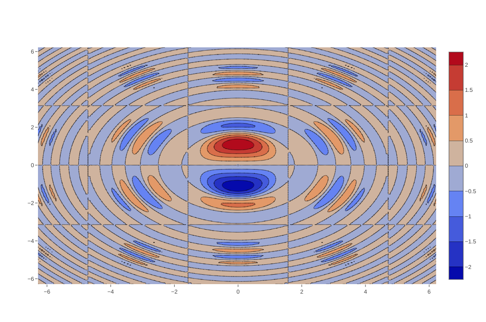
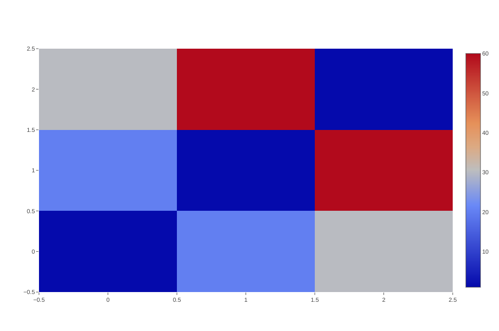

# Scientific Charts

The source code for the following examples can also be found [here](https://github.com/plotly/plotly.rs/tree/main/examples/scientific_charts).

Kind | Link
:---|:----:
Contour Plots |
Heatmaps | 
Ternary Plots | [Ternary Plots](./scientific_charts/ternary_plots.md)
Smith Charts | [Smith Charts](./scientific_charts/smith_charts.md)
Carpet Plots | [Carpet Plots](./scientific_charts/carpet_plots.md)
